# Cacaiva · Red Nacional de Cacao

Aplicación para que un **productor de cacao** lleve el control de su finca desde
el celular, **en el campo y sin señal**.

Proyecto de seminario de grado desarrollado con el SENA / Tecnoparque, como
primer paso del ecosistema digital de la Red Nacional de Cacao.

| | |
|---|---|
| **Versión** | 1.6.0 (compilación 13) |
| **Estado** | Fase 1 cerrada: captura local, sincronización, cuentas de Google, reportes y costo por kilo |
| **Plataforma** | Android · Web ([redcacao.vercel.app](https://redcacao.vercel.app)) · iOS preparado, sin compilar todavía |
| **Tecnología** | Flutter · Drift/SQLite · Google Apps Script + Google Sheets · Google Sign-In |
| **Pruebas** | 217, todas en verde |
| **Base local** | Esquema v15, migraciones aditivas |

**Contenido**

1. [Qué problema resuelve](#1-qué-problema-resuelve)
2. [Recorrido por la app](#2-recorrido-por-la-app)
3. [Todo lo que tiene la app](#3-todo-lo-que-tiene-la-app)
4. [Cómo llegó hasta aquí](#4-cómo-llegó-hasta-aquí)
5. [Arquitectura](#5-arquitectura)
6. [Arquitectura de datos](#6-arquitectura-de-datos)
7. [Sincronización](#7-sincronización)
8. [Sistema de identidad](#8-sistema-de-identidad)
9. [El servidor: Google Apps Script](#9-el-servidor-google-apps-script)
10. [Instalación y ejecución](#10-instalación-y-ejecución)
11. [Pruebas](#11-pruebas)
12. [Migraciones de la base local](#12-migraciones-de-la-base-local)
13. [Estado del proyecto](#13-estado-del-proyecto)
14. [Seguridad y privacidad](#14-seguridad-y-privacidad)
15. [Mapa del código](#15-mapa-del-código)
16. [Capturas de pantalla](#16-capturas-de-pantalla)
17. [Documentos del proyecto](#17-documentos-del-proyecto)
18. [Créditos](#18-créditos)

---

## 1. Qué problema resuelve

El productor de cacao anota hoy sus labores y cosechas en cuadernos o no las
anota. Cuando llega el técnico del SENA o de FEDECACAO, no hay historial: no se
sabe cuándo se podó, cuánto se cosechó ni cómo viene el lote. Y cuando alguien
le pregunta cuánto le cuesta producir un kilo, casi nadie sabe responder.

Esta aplicación reemplaza ese cuaderno, con una condición que manda sobre todo lo
demás: **en la finca no hay señal**. Por eso todo se guarda primero en el
teléfono y se sincroniza después, cuando haya internet.

**Para quién es:** productores de cacao, con celulares de gama baja o media, que
usan la app de pie, al sol y con las manos ocupadas. De ahí que todo sea grande,
que haya poco texto en pantalla, que se pueda dictar en vez de escribir y que las
preguntas se hagan con palabras del campo ("Fumigar o curar", "Abonar").

### Qué se puede registrar

```
Productor            (nombre, documento, teléfono, correo, asociación)
 └── Fincas          (nombre, departamento, municipio, ubicación GPS)
      └── Lotes      (código, variedad, área, fecha de siembra, punto GPS propio)
           ├── Labores        (siembra, poda, fertilización, control fitosanitario,
           │                   riego, otra) con responsable, costo, producto, dosis...
           ├── Cosechas       (kilos, fecha, tipo de producto)
           └── Diagnósticos   (estado fenológico y notas)
```

---

## 2. Recorrido por la app

Las capturas salen de la aplicación real, con los datos inventados de una finca
ficticia (ver [capturas de pantalla](#16-capturas-de-pantalla)).

### 2.1 Bienvenida y registro

Lo primero que se ve al instalar. El registro es en **dos pasos** —sus datos y su
finca— y al terminar se pregunta si tiene otra finca. Arriba de cada formulario
hay una tarjeta que dice **"¿Tiene dudas? Vea el video"**: el video tutorial está
guardado dentro de la app y se ve **sin internet**.

| | | |
|:---:|:---:|:---:|
| 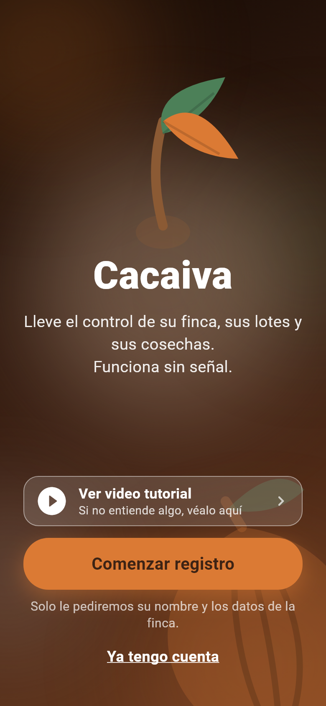 | 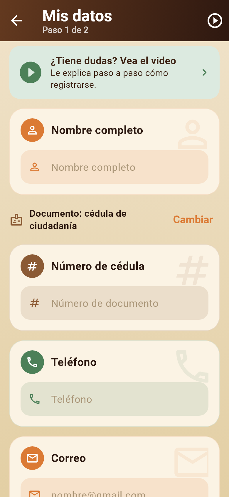 | 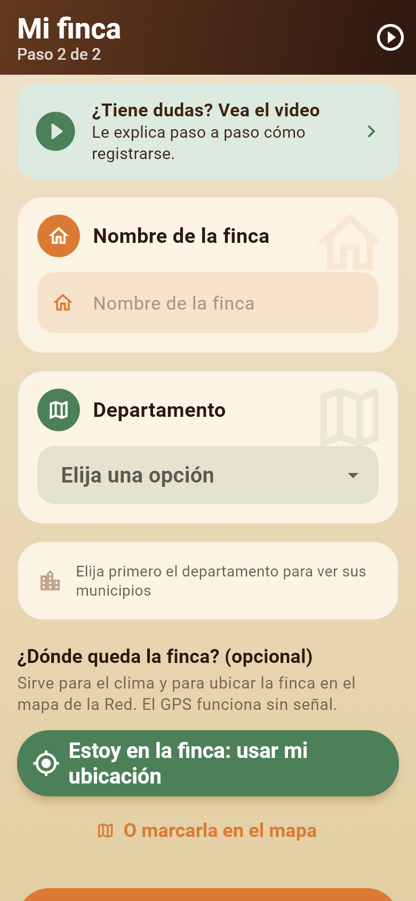 |
| Bienvenida, con el video tutorial y "Ya tengo cuenta" | Paso 1 de 2: datos del productor | Paso 2 de 2: la finca |

### 2.2 Inicio

La pantalla de todos los días: la finca (se cambia tocando su nombre), la cinta de
sincronización, el resumen del año, los recordatorios y los lotes.

| | |
|:---:|:---:|
| 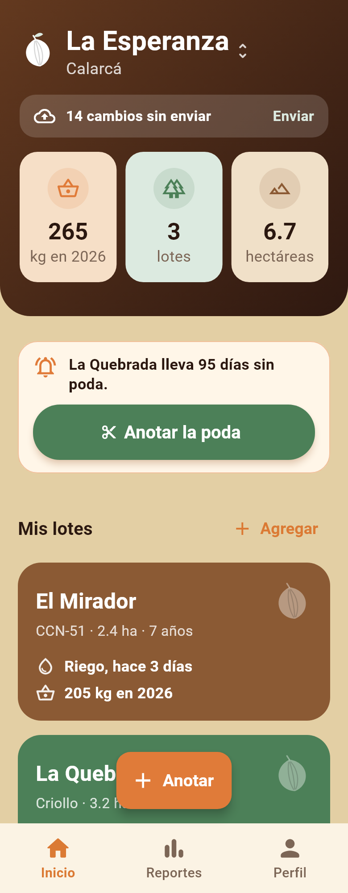 | 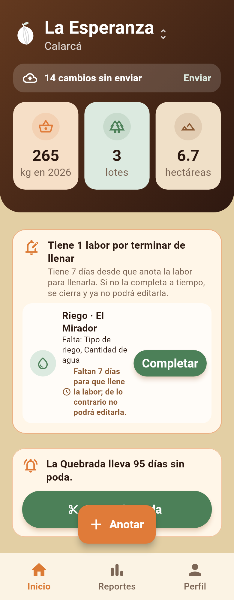 |
| Inicio: **"14 cambios sin enviar"** (todo funciona sin señal), el recordatorio de poda y los lotes | Cuando una labor quedó a medias, el Inicio lo avisa y dice cuántos días quedan para completarla |

### 2.3 El lote

Tres pestañas: **Labores**, **Cosechas** y **Estado** (diagnósticos). Cada labor
muestra lo que se anotó: tipo, producto, cantidad, responsable y costo. Arriba, la
producción del año y cuánto tiempo queda para corregir los datos del lote.

| | | |
|:---:|:---:|:---:|
| 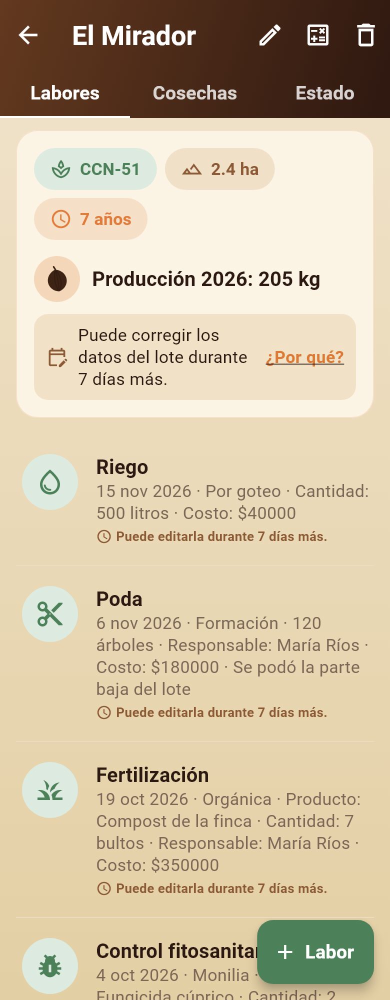 | 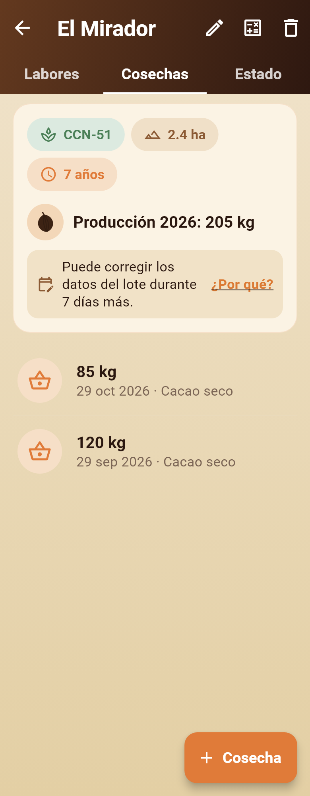 | 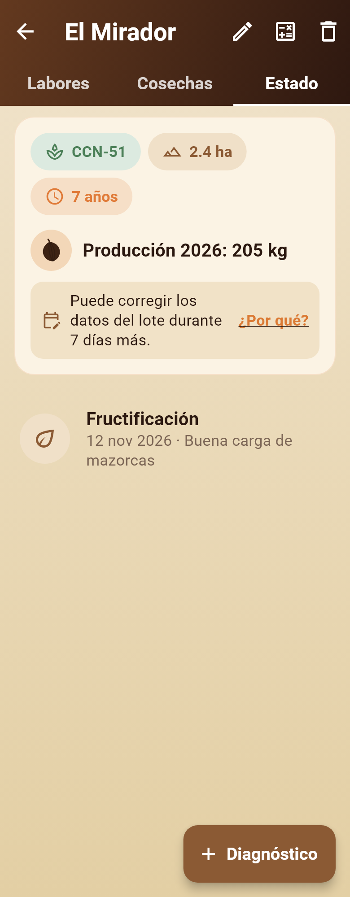 |
| Labores | Cosechas | Estado del cultivo |

### 2.4 Anotar

El botón naranja **Anotar** está siempre a la mano. Escoge el lote (si hay más de
uno) y luego **una labor** o **una cosecha**. La labor se registra con solo el tipo
—seis botones grandes con ícono— y la fecha; lo demás va en "Agregar más
detalles". La nota **BPA** explica, ahí mismo, para qué sirve anotar eso frente al
ICA.

| | |
|:---:|:---:|
| 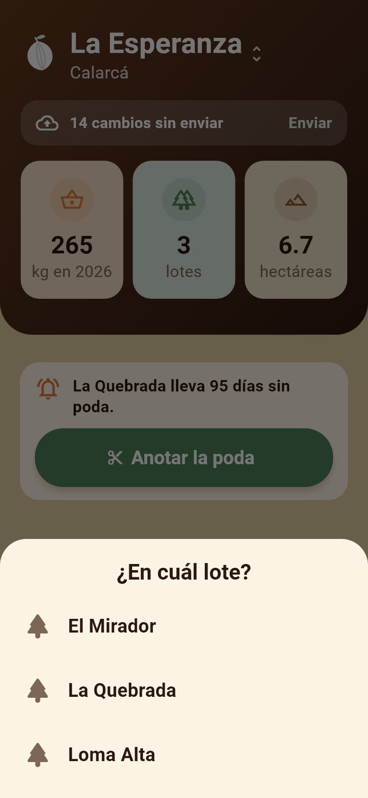 | 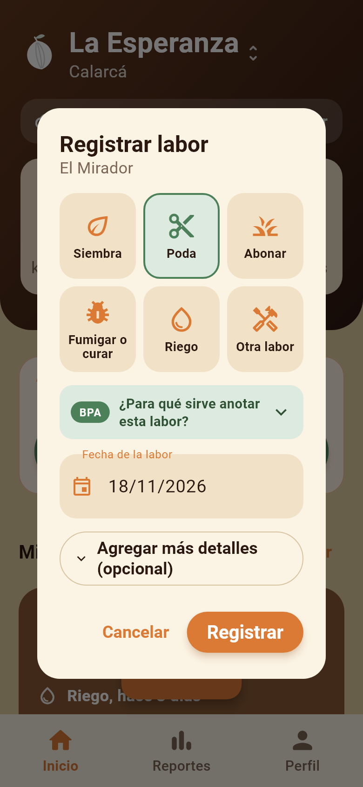 |
| Escoger el lote | Registrar una labor |

### 2.5 Reportes

Responde "¿cómo va la finca en total?". Se puede ver una finca o **todas juntas**.

| | | |
|:---:|:---:|:---:|
| 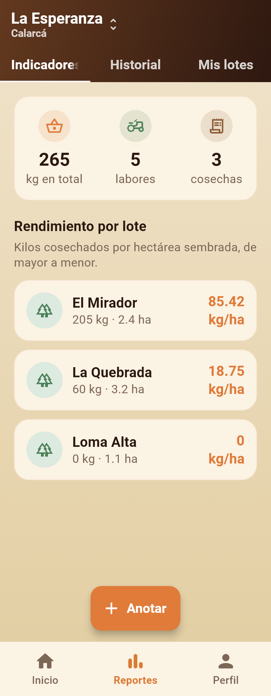 | 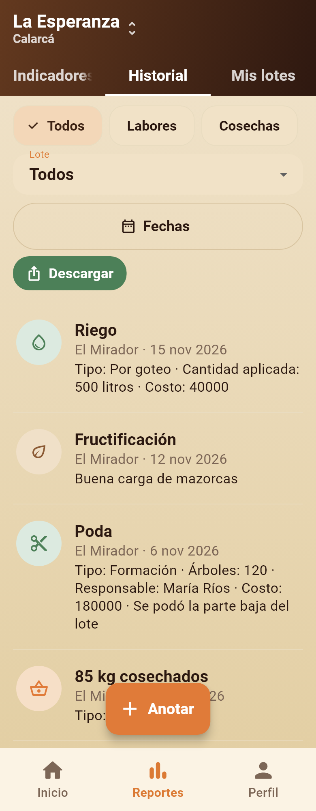 | 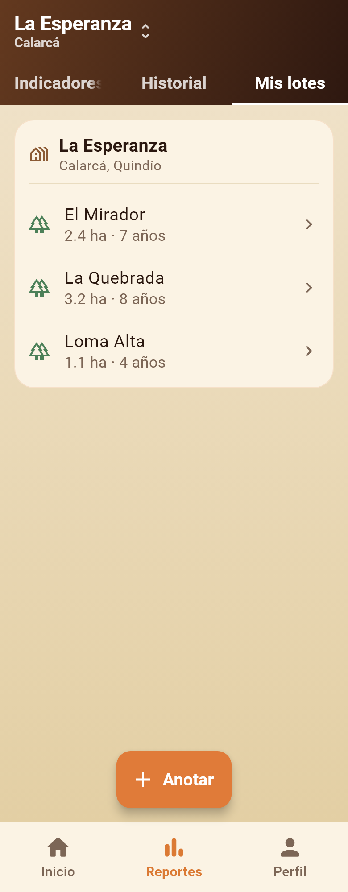 |
| Indicadores: kilos, labores y rendimiento por hectárea de cada lote | Historial con filtros por tipo, lote y fechas, y botón **Descargar** (Excel o PDF) | Mis lotes, agrupados por finca |

### 2.6 Costo por kilo (en prueba)

Toma las labores y las cosechas de un lote en un período y responde cuánto le
costó producir un kilo y, si el productor escribe a cómo le pagan, cuánto le queda.
Para quien nunca ha sacado esa cuenta, un **asistente** le pregunta una cosa a la
vez.

| | |
|:---:|:---:|
| 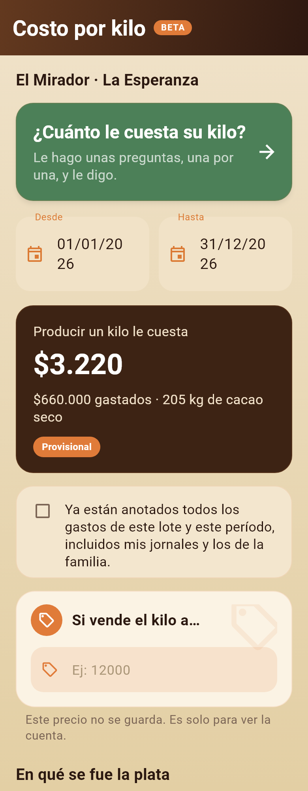 | 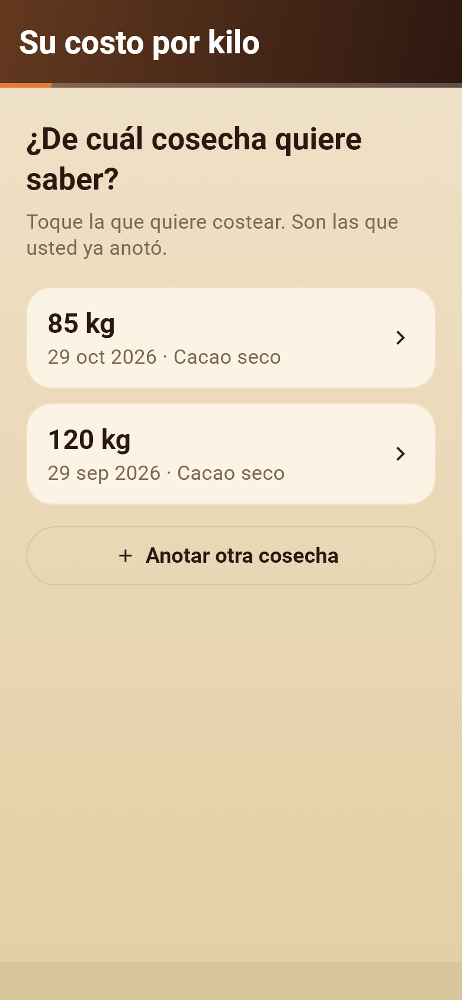 |
| La cuenta, con el sello **Provisional** mientras nadie confirme que están todos los gastos | El asistente: "¿De cuál cosecha quiere saber?" |

### 2.7 Perfil y ayuda

El perfil junta los datos del productor, el estado de la cuenta ("Sin cuenta: sus
datos están solo en este teléfono" o "Sus datos están respaldados") y la tarjeta de
**Ayuda**, con el video de registro y los videos del canal de Cacaiva.

| | |
|:---:|:---:|
| 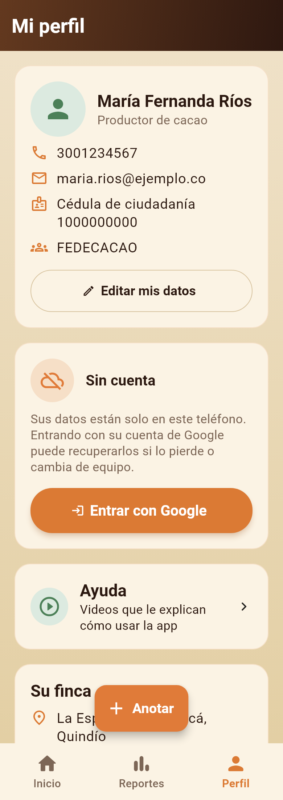 | 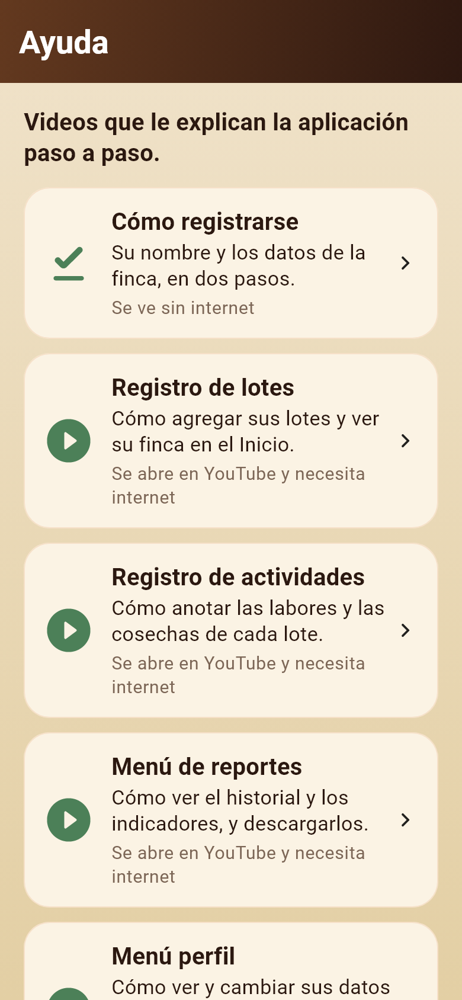 |
| Perfil | Ayuda: un video se ve sin internet, los otros se abren en YouTube |

> El **mapa** para ubicar la finca y el lote, y el **reproductor del video** no
> salen en las capturas generadas (necesitan internet y un reproductor); se ven en
> la app.

---

## 3. Todo lo que tiene la app

De lo más básico a lo más nuevo.

### Registro y datos del productor

- Registro en **dos pasos** (productor y finca) y la pregunta "¿Tiene otra finca?".
- **Productor**: nombre, **documento** (tipo y número), teléfono, correo y
  **asociación**.
- **Validaciones** hechas para el campo: el nombre no admite números, el teléfono
  solo dígitos, el correo bien escrito. El correo es opcional: muchos productores
  no tienen.
- **Asociaciones**: catálogo que viene de fábrica (FEDECACAO, FEPCACAO, ASOMUSTIC,
  APROCAVILLA, AMUCAFUE) más "Otra, especificar", que crea una nueva y la
  sincroniza.
- **Varias fincas por productor**, con un selector en el Inicio para cambiar de
  finca sin pasar por el perfil.
- **Departamentos y municipios de Colombia** (listado DIVIPOLA) en desplegables:
  el departamento limita los municipios.

### Ubicación

- **Ubicación de la finca con el GPS** ("Estoy en la finca"), que funciona sin
  señal, o **en el mapa** (OpenStreetMap), sin escribir coordenadas.
- **Verificación del municipio**: el mapa abre centrado en el departamento y
  comprueba que el punto caiga donde el productor dijo. En la finca, si no
  concuerda, deja seguir "de todas formas": los límites municipales son borrosos.
- **Punto GPS de cada lote**, aparte del de la finca, que es el dato que pide el
  comprador que exporta. Se marca con el GPS o con el dedo en el mapa.
- **Perímetro de la finca**: un lote solo se puede marcar dentro del radio que
  sale de las hectáreas registradas (lado del cuadrado equivalente, por su
  diagonal, más 20 %; nunca menos de 300 m ni más de 5 km). Si el punto cae
  fuera, la app dice cuánto se pasó y que lo más probable es que el mal puesto sea
  el de la finca.

### Lotes, labores, cosechas y diagnósticos

- **Lotes** con código, variedad (con atajos como CCN-51 o ICS-95), área en
  hectáreas y fecha de siembra. La **edad del cultivo no se pregunta**: se
  calcula.
- **Labores** de seis tipos: siembra, poda, fertilización, control fitosanitario,
  riego y otra. El formulario muestra solo lo que aplica al tipo escogido (tipo de
  poda y árboles, producto y cantidad, incidencia, árboles sembrados y marco de
  plantación...), más responsable y costo. "Otra labor" obliga a decir qué fue.
- **Anotar rápido**: la labor se registra con solo el tipo y la fecha.
- **Cosechas** con kilos, fecha y tipo de producto: cacao en baba, fermentado o
  seco.
- **Diagnósticos** del estado fenológico: vegetativo, floración, cuajado,
  fructificación, maduración y cosecha, con notas.
- **Producción anual** calculada en vivo, por lote y por finca.
- **Última labor** de cada lote a la vista ("Riego, hace 3 días").
- **Corregir lo anotado a la carrera**: una labor o un lote se puede editar
  durante **7 días**. Pasado el plazo se cierra y solo el administrador puede
  volver a habilitarlo, para que los reportes sigan sirviendo como prueba. El
  Inicio avisa "Tiene 3 labores por terminar de llenar" y dice qué campo falta en
  cada una.
- **Borrado suave con cascada**: borrar un lote arrastra sus registros, y nada se
  borra físicamente, para que los demás teléfonos se enteren.
- **Notas de buenas prácticas (BPA)**: cada formulario de registro lleva una nota
  plegada con el sello BPA que explica para qué sirve anotar eso, con base en la
  Resolución ICA 30021 de 2017. Siempre cierra con "Esto le orienta; no lo
  certifica". Quien certifica es el ICA.

### Ayudas para el campo

- **Dictado por voz** en las observaciones, en español (con preferencia por
  Colombia), que aguanta pausas largas y va acumulando las frases.
- **Palabras del campo** en los formularios, neutras: "Cantidad aplicada",
  "Árboles tratados".
- **Recordatorios** en el Inicio ("La Quebrada lleva 95 días sin poda", con un
  botón para anotarla) y **comparación con el año pasado a la misma fecha**.
- **Confirmación animada** al guardar.
- **Video tutorial de registro** guardado dentro de la app, con una leyenda en la
  bienvenida y una tarjeta en cada paso del registro.
- **Ayuda**: lista de videos del [canal de Cacaiva](https://www.youtube.com/channel/UCv3denL0TKZTuN_nyv2BnkA)
  (lotes, actividades, reportes y perfil).

### Reportes y costos

- **Indicadores**: kilos, labores, cosechas y **rendimiento por hectárea** de cada
  lote, de mayor a menor.
- **Historial** de todos los lotes en una sola línea de tiempo, con filtros por
  tipo, lote y fechas, que muestra lo que de verdad se anotó (tipo, producto,
  responsable, costo).
- **Descargar a Excel o PDF**, exactamente lo que se ve con los filtros, y un
  **historial completo del productor en PDF**, por finca y por lote, con las
  fechas elegidas.
- **Mis lotes**: todas las fincas con sus lotes.
- **Costo por kilo** (en prueba):
  - un **asistente** que pregunta una cosa a la vez: de cuál cosecha, desde cuándo,
    cinco gastos (poda, abono, fumigación, riego, otros) y si trabajó la familia
    sin cobrar;
  - **no da el número hasta que está lo obligatorio** y dice qué falta; tres estados:
    pendiente, provisional y gastos confirmados;
  - **no suma kilos de productos distintos** (un kilo de baba no es uno de seco);
  - **reparte por hectáreas** un gasto que fue de varios lotes, y muestra la
    cuenta antes de guardar;
  - los gastos se anotan y se corrigen desde la misma pantalla: es una labor del
    lote, no una contabilidad aparte;
  - el precio de venta **no se guarda** todavía, y la pantalla lo dice.

### Sincronización y cuentas

- **Funcionamiento sin internet** de toda la app.
- **Sincronización con la nube**: subida de cambios pendientes, descarga
  incremental, reglas de conflicto y cascadas remotas. La cinta del Inicio cuenta
  los cambios sin enviar.
- **Respaldo periódico** cada 15 minutos, con espera creciente (hasta 60) si la
  señal falla, para no gastar datos insistiendo.
- **Tiempo de espera de 30 segundos** en cada salto al servidor: con señal mala la
  app avisa que lo anotado está guardado en el teléfono, en vez de quedarse
  "sincronizando" para siempre.
- **Cuenta con Google**: llega ya verificada y la app nunca ve ni guarda
  contraseñas. **Ya tengo cuenta** recupera los datos en otro teléfono.
- **Cerrar sesión** y **cambiar de cuenta**, que borran los datos de ese teléfono
  avisando antes si hay cambios sin enviar.
- **Administrador del SENA**: el servidor reconoce a los correos de una lista que
  ven las filas de todos los productores y **no pueden escribir ninguna**: el
  panel sirve para acompañar, no para corregirle el cuaderno al productor.

### Publicación

- **Versión web** con el mismo código, publicada en
  [redcacao.vercel.app](https://redcacao.vercel.app), con la
  [política de privacidad](https://redcacao.vercel.app/privacidad) y las
  [condiciones de uso](https://redcacao.vercel.app/condiciones).
- **Instalable como app web** (PWA básica): íconos propios y manifiesto.
- **APK que se instala encima de la anterior** sin perder los datos: firma con una
  llave propia del equipo y número de compilación que sube en cada entrega.
- **Identidad**: la app se llama **Cacaiva**; el brote dibujado por el equipo, el
  emblema de la Red como ícono y una paleta de cacao con letra grande.

### Lo que se quitó a propósito

- **Las fotos** de los formularios. El ICA lo pidió por medio del instructor, y
  coincidía con algo que quedó a la vista al escribir la política de privacidad:
  la foto nunca salía del teléfono, solo viajaba la ruta del archivo, que no sirve
  en otro equipo. Era una función que prometía respaldar la evidencia y no la
  respaldaba. Con ella se fueron la dependencia de la cámara y los permisos de
  cámara y galería.

---

## 4. Cómo llegó hasta aquí

| Fecha | Qué pasó |
|---|---|
| 2 sep 2026 | **Primera versión**: app offline-first con captura local, sincronización con Supabase, identidad separada en instalación y cuenta, interfaz para el campo. 121 pruebas. |
| 19 sep | **Módulo 1**: documento del productor, varias fincas, asociaciones, PWA básica, respaldo periódico y validaciones de los formularios. |
| 21 sep | **Cambio de nube**: de Supabase a Google Apps Script con cuenta de Google. Ingreso con Google también en la web. Actualizar la APK sin desinstalar (v1.1.0). |
| 22–23 sep | Emblema de la Red como logo. Entran los **reportes y la exportación** que armó el equipo, los campos nuevos de la labor, la **cara de la app del equipo**, el historial completo, el dictado por voz y la **corrección de labores**. |
| 23–24 sep | La app pasa a llamarse **Cacaiva** (v1.2.0 y 1.2.1). |
| 25 sep | El servidor reconoce al **administrador del SENA**, de solo lectura. |
| 28–29 sep | **Punto GPS del lote**, perímetro de la finca, verificación con OpenStreetMap, formularios con validación (v1.3.0). La sincronización deja de esperar para siempre y la web se repara sola si su base no abre. |
| 9 oct | **Política de privacidad y condiciones de uso**, que Google exige para abrir el registro al público. |
| 15 oct | Se **quitan las fotos** y se agrega la **nota BPA** en cada registro (v1.5.0). |
| 22 oct | **Video tutorial** guardado en la app, leyenda en la bienvenida, pantalla de **Ayuda** con los videos del canal de Cacaiva. Publicado en redcacao.vercel.app. |
| 28–29 oct | **Costo por kilo** en prueba, con asistente y reparto de gastos por hectáreas (v1.6.0). |
| 18 nov | README completo y capturas nuevas para la entrega final. |

---

> 📘 **¿Cómo está hecho por dentro?** El detalle técnico —decisiones,
> algoritmos, trampas y los problemas reales que aparecieron— está en
> [`docs/DOCUMENTACION_TECNICA.md`](docs/DOCUMENTACION_TECNICA.md).

## 5. Arquitectura

> Los diagramas formales que pide el seminario —arquitectura, IDEF0 A0 y A1,
> entidad-relación— están en [`docs/MODELOS.md`](docs/MODELOS.md). Aquí va el
> resumen técnico.

```
        Flutter (UI)
             │
        Repositories          PerfilRepository · LoteRepository · ReportesRepository
             │
    Base de datos local       Drift / SQLite  ← FUENTE DE VERDAD
             │
        SyncService           push → pull, cursor, conflictos
             │
         ApiRemota            (interfaz)
        ┌────┴─────┐
   ApiRemotaFalsa  ApiAppsScript
     (tests)            │
              Apps Script / Google Sheets
```

La aplicación es **offline-first**. Eso significa, en concreto:

1. La UI **nunca** espera al servidor. Guarda en local y sigue.
2. Cada fila escrita queda marcada como `pending`.
3. Cuando hay red, `SyncService` sube lo pendiente y baja lo nuevo.
4. Las filas ya sincronizadas quedan `synced`.

`ApiRemota` es una interfaz a propósito: los tests corren contra
`ApiRemotaFalsa` (un servidor en memoria, sin red) y la app real contra
`ApiAppsScript`. Cambiar de una a otra no toca la UI, ni los repositorios, ni los
DAOs, ni la lógica de sincronización. Esa misma separación fue la que permitió
cambiar de Supabase a Apps Script sin reescribir la app.

---

## 6. Arquitectura de datos

Siete tablas de datos —`asociaciones`, `productores`, `fincas`, `lotes`,
`actividades_agricolas`, `cosechas`, `diagnosticos`— más dos de servicio:
`sesion` y `sync_meta`.

Todas las tablas de datos comparten el mixin `SyncColumns`:

| Columna | Para qué |
|---|---|
| `id` | **UUID generado en el dispositivo**, no autoincremental |
| `created_at` / `updated_at` | Reloj del teléfono |
| `deleted_at` | **Borrado suave**: la fila no se borra, se marca |
| `server_updated_at` | Sello que puso el servidor (único reloj comparable) |
| `sync_status` | `pending` · `synced` · `error` |
| `sync_error` | Motivo del último fallo de subida |

**Por qué UUID en el dispositivo:** dos teléfonos sin señal pueden crear
registros al mismo tiempo sin chocar cuando por fin sincronicen.

**Por qué borrado suave:** un teléfono que estuvo un mes sin señal tiene que
poder enterarse de que algo se borró. Un `DELETE` no deja rastro que propagar.

**Cascadas:** borrar un lote marca `deleted_at` en el lote **y** en sus
actividades, cosechas y diagnósticos, en una sola transacción, dejando todo
`pending` para que el borrado también viaje.

**Reparación al abrir:** la base compara cada tabla con la definición actual y
agrega las columnas que falten. En el navegador, si la base no abre, se rehace y
vuelve a bajar del servidor; en el celular **nunca**: allá la base local es el
original y borrarla sería perder el trabajo del productor.

---

## 7. Sincronización

Cada pasada hace **push y después pull**, entidad por entidad y respetando las
dependencias:

```
productores → fincas → lotes → actividades · cosechas · diagnósticos
```

### Subida (push)

```
filas pending → ApiRemota.subir() → el servidor sella updated_at
             → serverUpdatedAt local ← sello    → sync_status = synced
```

### Descarga (pull)

```
cursor (lastSyncAt, lastSyncId) → descargar ordenado por (updated_at, id)
                                → aplicar fila por fila → guardar cursor
```

**El cursor es compuesto `(updated_at, id)`** y se guarda en `sync_meta`. No es
un capricho: con un cursor de solo tiempo, varias filas selladas en el mismo
segundo se pierden o se repiten para siempre. La primera versión de este código
entró en un bucle infinito por exactamente eso, y el test de paginación lo cazó.

Otras garantías del ciclo:

- **Idempotencia**: aplicar dos veces la misma fila no cambia nada (se compara
  `serverUpdatedAt` con el sello recibido).
- **Descarga interrumpida**: si falla a mitad, **el cursor no avanza**; la
  siguiente pasada repite el tramo.
- **Reintentos**: un fallo de red deja la fila `pending` y la cinta del inicio
  la sigue contando. No se pierde nada.
- **Paginación** por la misma clave, con avance garantizado.
- **Columna ausente no es nula**: si la hoja del servidor todavía no tiene una
  columna nueva, el valor que el productor escribió en el teléfono se conserva.
  Solo una columna presente y vacía significa "nulo".
- **Tiempo de espera** de 30 segundos en cada salto de red.

### Reglas de conflicto (las reales, implementadas)

1. **Push antes que pull.** Por lo tanto **gana el último en sincronizar**, no
   el último en editar. La regla no depende del reloj de ningún teléfono.
2. **Una fila remota nunca pisa una fila local `pending`.** Gana lo local y el
   choque queda anotado como conflicto en el `SyncResult`.
3. **Hijo sin padre**: si llega una finca cuyo productor no está aquí, se
   aplaza, se anota y el cursor no avanza. La próxima pasada lo reintenta.
4. **Hijo vivo con padre borrado**: entra **ya borrado**; no se revive el padre.
5. **Padre borrado en el servidor**: se dispara la cascada local y los hijos
   quedan borrados y **`synced`**, nunca `pending` — si quedaran pendientes,
   este teléfono subiría un borrado que nunca decidió.

---

## 8. Sistema de identidad

Es la parte más sutil del proyecto. Hay **tres** identificadores distintos y
conviene no confundirlos:

| Identificador | Qué representa | ¿Cambia? |
|---|---|---|
| `id` de cada fila | La fila en sí (UUID) | **Nunca** |
| `sesion.usuarioId` | **La instalación** (este teléfono) | Nunca |
| `sesion.authUid` | **La cuenta** de Google (su `sub`) | Solo si se entra con otra cuenta |

Y el dueño de los datos se expresa distinto en cada lado:

- **Local**: `productores.usuarioId` = la instalación.
- **Remoto**: `productores.usuario_id` = la cuenta.

La traducción entre ambos ocurre en los mapeadores, y es justamente lo que
permite que otro teléfono adopte los datos sin reescribir un solo UUID ni una
clave foránea.

### El recorrido

```
Instalación sin internet
      ↓
usuarioId local (UUID)          ← se puede trabajar ya, sin cuenta
      ↓
(sin cuenta: todo se queda en el teléfono, nada se sube)
      ↓
entrar con Google → authUid = `sub` de Google
      ↓
primera sincronización          ← lo anotado antes sube y queda a su nombre
```

**Regla dura del código:** lo anotado antes de entrar **no se pierde**. Al abrir
sesión, esas filas siguen `pending` y suben con su dueño ya puesto. Y el
servidor nunca deja escribir sobre una fila que ya tiene otro dueño.

### Dos teléfonos, una cuenta

```
Teléfono A                        Teléfono B
instalación A                     instalación B
      └──── misma cuenta de Google ────┘
                   │
            Apps Script / Sheets
```

B entra con la misma cuenta, baja las filas y **las adopta con su propia identidad de
instalación**. Los `id` y las claves foráneas viajan intactos. Mientras la
primera descarga no termina, la app **bloquea el registro** para que no aparezca
un productor duplicado bajo la misma cuenta.

---

## 9. El servidor: Google Apps Script

Hasta septiembre de 2026 el backend fue **Supabase (PostgreSQL)**. Se cambió a
un script sobre una hoja de cálculo de Google. El motivo no fue técnico: la
cuenta es del equipo, no depende de un tercero, no se apaga por inactividad, y
los técnicos pueden mirar los datos en una hoja. A cambio se pierde una base de
datos de verdad, y eso hay que tenerlo presente.

- Una **hoja de cálculo** guarda las mismas siete tablas de datos (sin
  `sync_status` ni `sync_error`, que son estado local).
- **`updated_at` lo escribe el servidor**, ignorando lo que mande el cliente. Un
  teléfono con la hora mal no puede envenenar la sincronización.
- **`usuario_id` también lo escribe el servidor**, sacado de la sesión: el
  filtro "cada quien ve lo suyo" no depende de lo que mande el teléfono.
- Todas las fechas viajan como texto **ISO-8601 en UTC**.
- La identidad la da **Google**: el script verifica el token contra Google y
  comprueba que sea de esta app antes de abrir sesión.
- El script lee y escribe **por el encabezado real de la hoja**, no por el orden
  de una lista: agregar una columna y volver a ejecutar `instalar()` no descoloca
  las filas ya guardadas.
- Una lista de **`ADMINISTRADORES`** (los correos del SENA) ve las filas de todos
  y no puede escribir ninguna. Se comprueba contra el correo de la sesión en cada
  petición, así que sacar a alguien de la lista le quita el acceso al instante.

El script y la guía de instalación están en [`backend/`](backend/). Tres cosas
que cuestan horas si no se saben:

1. Las peticiones van como `text/plain`. Con `application/json` el navegador
   hace una petición previa que Apps Script no contesta, y la versión web deja
   de sincronizar sin decir por qué.
2. Un `POST` responde con una redirección, y el destino solo acepta `GET`. El
   cliente sigue esa redirección a mano (en la web la maneja el navegador).
3. Cada cambio en el script necesita **publicar una versión nueva**, o la
   dirección sigue sirviendo el código viejo.

Y una más que solo aparece contra el servidor real: **la hoja solo guarda texto**.
Una celda vacía llega como cadena vacía, no como nulo, y los números llegan como
texto; el cliente lo traduce.

### Sin cuenta no hay servidor

Con Supabase había una sesión anónima que respaldaba aunque nadie hubiera
entrado. Con Google eso ya no es posible: **quien no entra trabaja solo contra
el teléfono**. La app funciona igual —el campo no espera a la nube— pero no hay
respaldo, y la pantalla de perfil lo dice sin rodeos.

### Configuración

La dirección del servidor y los identificadores de OAuth viven en
`lib/data/sync/config_nube.dart` y se pueden pasar por línea de comandos:

```bash
flutter run \
  --dart-define=NUBE_URL=https://script.google.com/macros/s/.../exec \
  --dart-define=GOOGLE_CLIENTE_WEB=...apps.googleusercontent.com
```

Si no hay dirección configurada, la app arranca contra el **doble en memoria** y
funciona igual; lo único que cambia es a dónde van los datos.

> Los identificadores de OAuth son públicos por diseño: viajan dentro de la app.
> Lo que protege la cuenta es la huella **SHA-1** registrada en Google (Android)
> y la lista de orígenes autorizados (web). El **secreto del cliente**
> (`GOCSPX-...`) no se usa en este diseño y **no debe estar en el repositorio**.

---

## 10. Instalación y ejecución

**Requisitos**

- Flutter 3.47 o superior (incluye Dart 3.13)
- Android SDK con API 36 y NDK (para compilar a Android)
- Una hoja de Google con el script de [`backend/`](backend/), si se quiere
  sincronizar de verdad

**Puesta en marcha**

```bash
flutter pub get
```

```bash
dart run build_runner build
```

```bash
flutter analyze
```

```bash
flutter test
```

```bash
flutter run
```

`build_runner` es necesario porque Drift genera código (`*.g.dart`) a partir de
las tablas.

**Compilar la APK**

```bash
flutter build apk --release
```

Para que se instale **encima** de la anterior sin perder datos, hay que firmarla
con la misma llave y subir el número de compilación. Está explicado en
[`docs/GUIA_ACTUALIZAR_APK.md`](docs/GUIA_ACTUALIZAR_APK.md).

**Versión web**

La página de la Red es **https://redcacao.vercel.app** — esa es la dirección
principal, la que se le pasa al productor. Hay otras dos que sirven lo mismo
(`web-rust-tau-65.vercel.app` y `redcacao-cacao3.vercel.app`), pero son
heredadas; para registrar orígenes en Google o para repartir el enlace, vale la
primera.

**Publicar la página**

```bash
tools/publicar_web.sh
```

Compila, sube, apunta las tres direcciones a lo recién subido y comprueba que
las tres contesten la versión del `pubspec.yaml`. Ese último paso no sobra: la
dirección principal está puesta a mano sobre una publicación concreta, no atada
a "lo último", así que un `vercel --prod` a secas deja la página vieja sin
avisar. Pasó: estuvo 38 días atrás del repositorio y solo se notó porque un
cambio nuevo "no aparecía".

> Lo correcto sería atarla en Vercel (proyecto `redcacao` → Settings →
> Domains); mientras no se haga, el script es lo que evita que vuelva a
> quedarse atrás.

El mismo proyecto compila a navegador, útil para mostrar la aplicación sin
instalar nada —por ejemplo, en un iPhone—:

```bash
flutter build web --release
```

Para probarla en el computador hay un servidor incluido, que hay que usar en vez
de un `http.server` normal:

```bash
python3 tools/servidor_web.py
```

Y se abre en `http://localhost:8099`.

> **Importante:** la base de datos del navegador necesita que la página se sirva
> con las cabeceras `Cross-Origin-Opener-Policy` y
> `Cross-Origin-Embedder-Policy: require-corp`. Sin ellas la app carga pero **no
> puede guardar datos**. Ya están configuradas para Netlify (`web/_headers`) y
> para Vercel (`vercel.json`). La de apertura es `same-origin-allow-popups`, no
> `same-origin`, para que la ventana de Google pueda devolver la cuenta.

> **Qué es y qué no es la versión web.** Sirve para *mostrar* la aplicación y,
> más adelante, para un panel de técnicos. **No sustituye a la app del
> productor**: el navegador guarda los datos en un almacenamiento que él mismo
> puede desalojar, mientras que en el teléfono el archivo SQLite es del sistema
> operativo. En el campo, esa diferencia lo es todo.

**Publicar el sitio oficial.** Con `tools/publicar_web.sh`, explicado más
arriba. Hace a mano exactamente esos pasos —compilar, desplegar `build/web` en
el proyecto `redcacao` y apuntar el alias— y además comprueba al final que las
tres direcciones hayan quedado en la versión nueva, que es el paso que se
olvida.

---

## 11. Pruebas

**230 pruebas**, todas en verde, y `flutter analyze` sin avisos. Se ejecutan con
`flutter test`; GitHub las corre solo en cada pull request ("Análisis y
pruebas").

| Archivo | Qué cubre |
|---|---|
| `database_test.dart` | Esquema, llaves foráneas, borrado suave |
| `borrado_cascada_test.dart` | Cascadas locales de lote, finca y productor |
| `perfil_productor_test.dart` | Registro en cascada, validaciones, varias fincas, inicio |
| `lote_detalle_test.dart` | Labores, cosechas, diagnósticos, borrar lote |
| `historial_detalle_test.dart` | El historial muestra lo que se anotó; labores a medias |
| `propuestas_test.dart` | Recordatorios, comparación con el año pasado y mejoras del campo |
| `perimetro_test.dart` | El lote solo se marca dentro del perímetro de su finca |
| `nota_bpa_test.dart` | La nota BPA está plegada y siempre aclara que no certifica |
| `costo_por_kilo_test.dart` | La cuenta: estados, productos distintos, gastos sin costo |
| `costo_por_kilo_ui_test.dart` | Anotar y corregir gastos desde la pantalla de costo |
| `asistente_costo_test.dart` | El recorrido completo del asistente |
| `reparto_gasto_test.dart` | Repartir un gasto entre lotes por hectáreas |
| `campo_de_plata_test.dart` | Los puntos de mil al escribir un costo, y que `1.500` se lea como mil quinientos |
| `barra_del_telefono_test.dart` | Nada queda debajo de la barra de botones de Android, y sin hueco doble |
| `selector_fecha_test.dart` | La fecha cabe en un renglón en un teléfono angosto |
| `tutorial_registro_test.dart` | El video está empaquetado, la leyenda y el fallo de reproducción |
| `ayuda_test.dart` | La pantalla de Ayuda y sus enlaces |
| `sync_productores_test.dart` | Ciclo completo de una entidad |
| `sync_fincas_test.dart` | Dependencias, hijo antes que padre, cascada remota |
| `sync_lotes_test.dart` | Paginación con sellos repetidos, conflictos, punto del lote |
| `sync_registros_test.dart` | Las tres hojas de registros, parametrizado |
| `sync_ui_test.dart` | Cinta de sincronización y estado pendiente |
| `nube_test.dart` | Un servidor que no contesta nunca no deja la app colgada |
| `cuentas_test.dart` | Entrar con Google, teléfono nuevo, dos instalaciones, conflictos, aislamiento, cerrar sesión, cambiar de cuenta |
| `cuentas_ui_test.dart` | Pantallas de cuenta y bloqueo de la descarga inicial |

### Qué se probó contra el doble (`ApiRemotaFalsa`)

Todo el ciclo de sincronización: subida, descarga incremental, cursor,
paginación, idempotencia, reintentos, conflictos, cascadas remotas, entrada con
Google dejando a su nombre lo anotado antes de entrar, teléfono nuevo con cuenta
existente, dos instalaciones compartiendo una cuenta, aislamiento entre cuentas
distintas y cambio de cuenta en un teléfono con datos.

### Qué se verificó contra el servidor real

Contra el servidor real de Apps Script y con cuentas de Google reales: creación
de las hojas con `instalar()`, **entrada con Google** en el emulador Android y en
el navegador, **subida** de productor, finca y lote con sello del servidor,
**borrado suave** viajando como `deleted_at`, y los campos nuevos de la labor
viajando completos. Una APK se instaló encima de la anterior conservando la finca
y la sesión.

**Lo que no se alcanzó a verificar en dispositivos reales** es la recuperación
completa en un segundo teléfono (inicio de sesión y descarga). Está implementado
y cubierto por tests contra el doble, pero **no confirmado de punta a punta con
dos teléfonos**. Tampoco se pudo probar en las pruebas automáticas la
reproducción real del video del tutorial.

---

## 12. Migraciones de la base local

| Versión | Qué introdujo |
|---|---|
| v1 | Modelo inicial: productores, fincas, lotes, actividades, cosechas, diagnósticos |
| v2 | Columnas de sincronización (`serverUpdatedAt`, `syncError`), `usuarioId`, tablas `sesion` y `sync_meta` |
| v3 | `lastSyncId`: el cursor pasa a ser compuesto |
| v4 | `correo` y `descargaInicial` en `sesion` (cuentas) |
| v5 | `correoConfirmado` en `sesion` |
| v6 | `tipoDocumento` y `numeroDocumento` en `productores` |
| v7 | `tokenNube` en `sesion` (sesión del servidor) |
| v8 | `codigo` del lote |
| v9 | Datos nuevos de la labor: responsable, costo, árboles sembrados, edad de la plántula, insumos |
| v10 | Tipo de labor (`subtipoLabor`), árboles afectados, edad del cultivo, resultado esperado |
| v11 | Producto, cantidad aplicada e incidencia |
| v12 | Tipo de producto de la cosecha |
| v13 | Foto del lote y nombre de la cuenta en `sesion` |
| v14 | `latitud` y `longitud` del lote (trazabilidad de exportación) |
| v15 | `costoTotalCompartido`: lo pagado completo cuando un gasto fue de varios lotes |

Todas son **aditivas**: agregan columnas o tablas, no borran datos ni cambian
identificadores. Las migraciones v8 a v12 llegaron con el módulo de reportes del
equipo y se renumeraron encima de la v7. Las columnas de foto siguen en la base
aunque la app ya no pida fotos: vaciarlas obligaba a una migración y a cambiar el
script de Google, sin ganar nada.

---

## 13. Estado del proyecto

| Funcionalidad | Estado |
|---|---|
| Gestión de productores (con documento y asociación) | ✅ Implementado |
| Gestión de fincas (varias, con GPS, mapa y verificación) | ✅ Implementado |
| Gestión de lotes (con punto GPS y perímetro) | ✅ Implementado |
| Labores, cosechas y diagnósticos | ✅ Implementado |
| Corrección de labores y lotes en 7 días | ✅ Implementado |
| Nota de buenas prácticas (BPA) en cada registro | ✅ Implementado |
| Funcionamiento offline-first | ✅ Implementado |
| Borrado suave y cascadas | ✅ Implementado |
| Sincronización con la nube | ✅ Implementado |
| Ingreso con cuenta de Google, cerrar sesión, cambiar de cuenta | ✅ Implementado |
| Reportes: indicadores, historial y mis lotes | ✅ Implementado |
| Exportación a Excel y PDF | ✅ Implementado |
| Recordatorios y comparación con el año pasado | ✅ Implementado |
| Dictado por voz | ✅ Implementado |
| Video tutorial de registro (sin internet) y pantalla de Ayuda | ✅ Implementado |
| Política de privacidad y condiciones de uso | ✅ Publicadas |
| Versión web | ✅ Publicada en redcacao.vercel.app; falta el service worker, así que la web no abre sin conexión |
| Costo por kilo | 🟡 En prueba: el precio de venta todavía no se guarda |
| Rol de administrador del SENA | 🟡 El servidor ya lo reconoce (solo lectura); falta la pantalla del panel |
| Recuperación en varios dispositivos | 🟡 Funciona con la misma cuenta de Google; falta dejar registro formal de la prueba con dos teléfonos |
| Compilación iOS | ⏳ Pendiente (permisos ya configurados) |
| Clima y alertas | ⏳ Fase 2 |
| Fotos en la nube | ➖ Retiradas: el ICA pidió quitarlas |
| Recuperación de contraseña | ➖ No aplica (la gestiona Google) |

---

## 14. Seguridad y privacidad

- **Cada petición se filtra por la sesión.** El servidor escribe el
  `usuario_id` de quien entró en todas las filas y nunca cree lo que manda el
  teléfono. Una fila que ya tiene otro dueño no se puede sobrescribir.
- Un usuario **no puede leer ni modificar** los datos de otro. La misma cuenta
  sí puede entrar desde varios dispositivos.
- El **administrador del SENA** ve las filas de todos y **no puede escribir**: el
  servidor rechaza esa escritura, así que el historial sigue sirviendo como
  prueba.
- **Las contraseñas las gestiona Google**; la app nunca las ve ni las guarda.
  Eso también quita de encima la recuperación de contraseña.
- El **secreto del cliente** de OAuth no se usa ni está en el repositorio.
- **El teléfono es el dueño del dato**; el GPS solo se enciende al tocar el botón.
- **Ya no hay fotos**: lo que se pidió fue retirarlas, y con ellas los permisos de
  cámara y galería.
- La [política de privacidad](https://redcacao.vercel.app/privacidad) y las
  [condiciones de uso](https://redcacao.vercel.app/condiciones) describen lo que la
  app hace de verdad, incluido lo incómodo: que es un proyecto académico, que se
  entrega tal como está y que, si se suspende, se avisará con tiempo para que cada
  quien descargue lo suyo.

**La cuenta llega verificada.** Antes hacía falta confirmar el correo y la app
tenía un tercer estado ("pendiente de confirmar"). Con Google eso desaparece: o
hay cuenta o no la hay.

> **Pendiente antes de abrirla a todo el público:** confirmar que la pantalla de
> consentimiento de Google salió del modo *Prueba* (la política de privacidad y las
> condiciones que Google pide ya están publicadas). Mientras esté en *Prueba* solo
> entran los correos de la lista y las sesiones caducan a los 7 días. La llave de
> firma de Android ya es propia del equipo; si se pierde o cambia sin registrar su
> huella SHA-1 en Google, el ingreso deja de funcionar.

---

## 15. Mapa del código

### Datos locales — `lib/data/local/`

| Archivo | Qué hay dentro |
|---|---|
| `tables.dart` | Las 9 tablas y el mixin `SyncColumns`. **Aquí se define el modelo.** |
| `database.dart` | `AppDatabase`, las migraciones, la reparación al abrir y las **cascadas de borrado** |
| `enums.dart` | `SyncStatus`, `TipoDocumento`, `TipoActividad`, `EstadoFenologico` |
| `colombia.dart` | Departamentos y municipios (DIVIPOLA) |
| `asociaciones_semilla.dart` | El catálogo de asociaciones que viene de fábrica |
| `recuperacion*.dart` | Rehacer la base del navegador si no abre (solo web) |
| `database.g.dart` | Generado por Drift. **No se edita a mano** |

### Consultas — `lib/data/daos/`

| Archivo | Qué hay dentro |
|---|---|
| `daos.dart` | `ProductoresDao`, `FincasDao`, `LotesDao`, `RegistrosDao` y `SyncDao` (identidad, cuenta y cursores) |

### Repositorios — `lib/data/repositories/`

| Archivo | Qué hay dentro |
|---|---|
| `perfil_repository.dart` | Productor, finca y lotes. Cálculos de edad y área |
| `lote_repository.dart` | Labores, cosechas y diagnósticos de un lote |
| `reportes_repository.dart` | Indicadores de gestión de una finca |
| `recordatorios.dart` | Avisos del Inicio, qué es una labor bien documentada y el plazo de 7 días |
| `costo_por_kilo.dart` | La cuenta del costo por kilo, sin guardar nada |

### Servicios — `lib/data/servicios/`

| Archivo | Qué hay dentro |
|---|---|
| `exportador_excel.dart` · `exportador_pdf.dart` | Arman el archivo y abren el panel de compartir del teléfono |
| `exportador_historial_productor.dart` | El historial completo del productor, por finca y por lote |
| `nombre_archivo.dart` | Nombres de archivo seguros |

### Sincronización — `lib/data/sync/`

| Archivo | Qué hay dentro |
|---|---|
| `sync_service.dart` | **El corazón**: push/pull, cursor, conflictos, cuentas |
| `api_remota.dart` | La interfaz con el backend |
| `api_apps_script.dart` | Implementación real (Apps Script) |
| `autenticador_google.dart` | Pide la cuenta a Google y entrega el token |
| `api_falsa.dart` | Servidor en memoria con cuentas, para tests y desarrollo |
| `config_nube.dart` | Dirección del servidor e identificadores de OAuth |
| `mapeador_*.dart` · `mapeadores_registros.dart` | Traducen fila local ↔ fila remota |
| `sync_result.dart` | Resultado de una pasada y motivos de conflicto |
| `sync_state.dart` | Estado observable para la interfaz |

### Interfaz — `lib/ui/`

| Archivo | Qué hay dentro |
|---|---|
| `cascaron_screen.dart` | El armazón: barra inferior, botón *Anotar*, respaldo periódico |
| `bienvenida_screen.dart` | Primera pantalla y registro en dos pasos |
| `inicio_screen.dart` | La pantalla de todos los días: finca, resumen, recordatorios y lotes |
| `lote_detalle_screen.dart` | Las tres pestañas del lote, el borrado y la entrada al costo por kilo |
| `reportes_screen.dart` | Indicadores, historial con filtros y exportación, y mis lotes |
| `costo_por_kilo_screen.dart` · `asistente_costo_screen.dart` | La cuenta y el asistente que pregunta una cosa a la vez |
| `perfil_screen.dart` | Datos de identidad, tarjeta de cuenta y tarjeta de Ayuda |
| `ayuda_screen.dart` | Lista de videos de ayuda |
| `tutorial_registro_screen.dart` | El video de registro, que se ve sin internet |
| `cuenta_screens.dart` | La espera mientras bajan los datos de la cuenta |
| `editar_productor_screen.dart` · `editar_finca_screen.dart` | Formularios |
| `mapa_screen.dart` | Mapa y GPS para ubicar la finca y el lote |
| `tema.dart` | `PaletaCacao`, tema, cabecera con degradado y fondo |
| `formato.dart` | Fechas, números y etiquetas en español |
| `dialogos/` | Diálogos de lote, labor, cosecha y diagnóstico |
| `widgets/` | Brote y mazorca dibujados en vector, campo con dictado, nota BPA, perímetro, selector de finca, verificación de ubicación, cinta de sincronización, confirmación de guardado y el botón de Google |

### Raíz y otros

| Archivo | Qué hay dentro |
|---|---|
| `lib/main.dart` | Arranque: base local, identidad, backend y `runApp` |
| `assets/tutorial_registro.mp4` | El video del tutorial, empaquetado en la app |
| `backend/Codigo.gs` | El servidor: sesiones, subida, descarga, sellos y administradores |
| `backend/GUIA_PASO_A_PASO.md` | Cómo dejarlo instalado en una cuenta nueva |
| `tools/servidor_web.py` | Servidor local con las cabeceras que exige la base del navegador |
| `tools/publicar_web.sh` | Publica la página y comprueba que las tres direcciones queden en la misma versión |
| `tools/generar_modelos.py` | Dibuja los modelos de `docs/modelos/` (SVG y PNG) |
| `tools/generar_capturas_test.dart` | Genera las capturas de `docs/capturas/` |
| `web/` | Página de arranque, manifiesto, íconos, política de privacidad y condiciones |
| `web/_headers` · `vercel.json` | Las cabeceras de la web para Netlify y Vercel |
| `presentacion/` | Páginas de presentación del proyecto |
| `test/utiles.dart` | Ayudas de tests (incluye por qué no se usa `pumpAndSettle`) |
| `android/app/src/main/AndroidManifest.xml` | Permisos y nombre visible |
| `ios/Runner/Info.plist` | Permisos de ubicación |

---

## 16. Capturas de pantalla

Están en [`docs/capturas/`](docs/capturas/) y **no se hacen a mano**: salen de la
misma interfaz que usa el teléfono, con una base en memoria llenada con una
productora y una finca ficticias. Nunca se usan datos de productores reales.

Cuando cambie la cara de la app, se regeneran con:

```bash
flutter test tools/generar_capturas_test.dart
```

Está en `tools/` y no en `test/` a propósito: no es una prueba, escribe archivos y
no debe correr en cada pull request.

---

## 17. Documentos del proyecto

| Documento | Para qué |
|---|---|
| [`docs/MODELOS.md`](docs/MODELOS.md) | Arquitectura, IDEF0 (A0 y A1) y entidad-relación de la app real, con PNG para el informe |
| [`docs/DOCUMENTACION_TECNICA.md`](docs/DOCUMENTACION_TECNICA.md) | Cómo está hecho cada componente y por qué, y los problemas reales que aparecieron |
| [`docs/GUIA_DEL_EQUIPO.md`](docs/GUIA_DEL_EQUIPO.md) | Cómo trabajar entre varios sin pisarse: ramas, pull requests, qué no se hace |
| [`docs/GUIA_DE_PRUEBAS.md`](docs/GUIA_DE_PRUEBAS.md) | Para quien recibe la APK y la prueba, sin saber programar |
| [`docs/GUIA_ACTUALIZAR_APK.md`](docs/GUIA_ACTUALIZAR_APK.md) | Repartir una APK nueva sin que se pierdan los datos |
| [`backend/README.md`](backend/README.md) · [`backend/GUIA_PASO_A_PASO.md`](backend/GUIA_PASO_A_PASO.md) | El servidor de Apps Script y su instalación |

---

## 18. Créditos

Seminario de grado · Ingenieros a cargo Jorge Aldana - Alexander Vera Tasama
Ingenieros en formacion: Andres Alzate - Andres Quiceno - Diego Parra - Esteban Gonzales - Miguel Marin - Samuel Martinez
SENA / Tecnoparque · 2026
