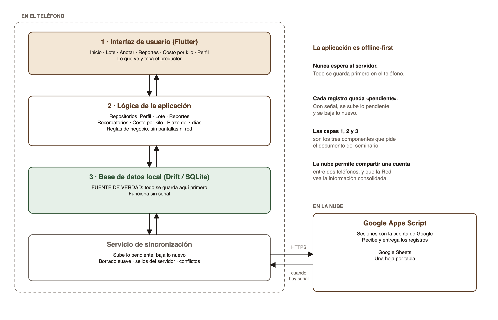
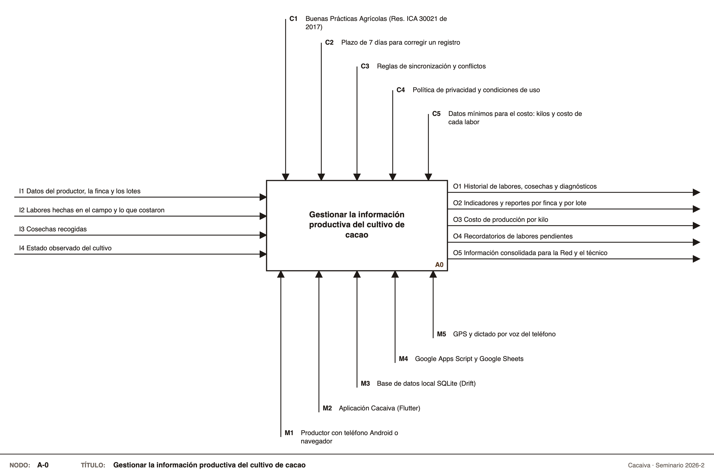
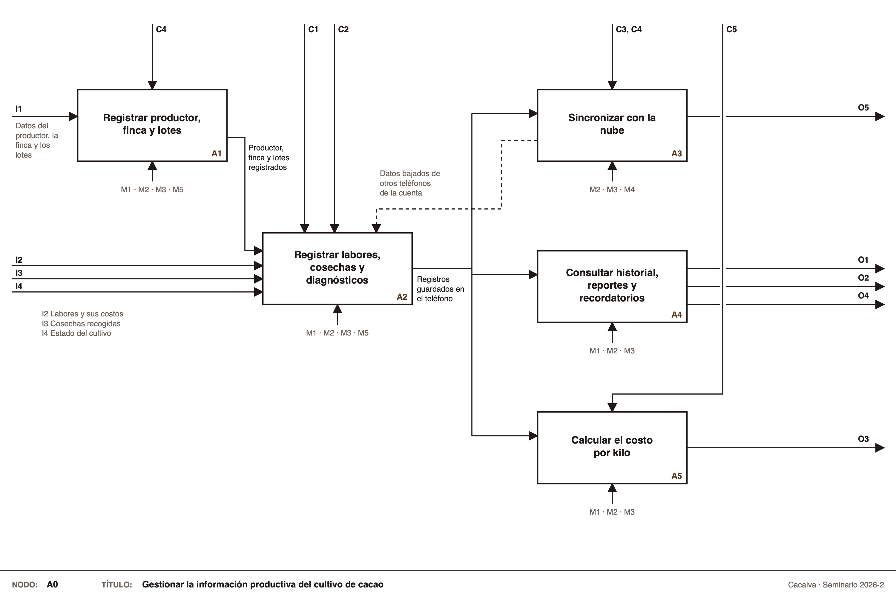
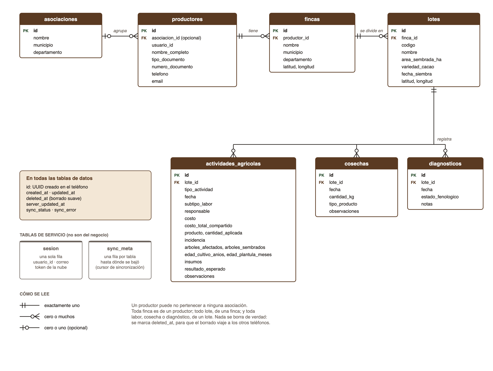

# Modelos del sistema

Los cuatro modelos que pide el documento del seminario —arquitectura (figura 3),
modelo funcional IDEF0 en sus niveles A0 y A1 (figuras 4 y 5) y modelo
entidad-relación (figura 6)—, **sacados de la aplicación que existe**, no de la
propuesta.

Cada figura está en dos formatos en [`modelos/`](modelos/): **SVG**, que se ve
nítido en GitHub y a cualquier tamaño, y **PNG** de 3000 píxeles de ancho, para
pegar en el informe de Word.

> **No se editan a mano.** Salen de [`tools/generar_modelos.py`](../tools/generar_modelos.py),
> donde el contenido de cada diagrama está escrito como texto, junto al código.
> Si cambia el esquema de la base o se agrega una función, se corrige allí y se
> vuelve a correr:
>
> ```bash
> python3 tools/generar_modelos.py
> ```
>
> Solo usa la biblioteca estándar de Python. Las PNG se generan en macOS; en
> otro sistema salen solo las SVG.

---

## Qué cambió respecto de la propuesta

La propuesta del seminario describía la aplicación antes de construirla. Al
construirla aparecieron cosas que el diseño inicial no tenía, y los modelos de
la entrega tienen que mostrar la aplicación real:

| En la propuesta | En la aplicación | Por qué |
|---|---|---|
| 4 entidades: Productor, Finca, Lote, Actividad agrícola | **7 entidades de negocio** más 2 de servicio | Ver las filas siguientes |
| La cosecha era un tipo de actividad | **Cosecha es su propia entidad** | Lleva kilos y tipo de producto (baba, fermentado, seco), que ninguna labor tiene. Mezclarlas obligaba a dejar esos campos vacíos en cada poda y a filtrar por tipo para cualquier cuenta de producción. |
| — | **Diagnóstico** del estado del cultivo | Floración, cuajado, maduración: es lo que el técnico revisa, y no es una labor que se le hizo al lote sino algo que se observó en él. |
| — | **Asociación** de productores | La Red agrupa a los productores por asociación; un productor puede no pertenecer a ninguna. |
| Arquitectura de tres componentes | Los mismos tres, **más una nube** | Sin ella, la información se queda en un solo teléfono. Ver la arquitectura. |
| Registrar y consultar | Además **recordatorios** y **costo por kilo** | Para que lo anotado le devuelva algo al productor: qué labor le toca y cuánto le cuesta producir. |

Lo que sí se mantuvo tal cual es la jerarquía de la propuesta: **productor →
finca → lote → registros**. Todo cuelga de un lote.

---

## 1. Arquitectura



*Figura 3. Arquitectura general de Cacaiva.*

Los tres componentes que pide el documento —interfaz de usuario, lógica de la
aplicación y base de datos— son las capas 1, 2 y 3, y viven completos **dentro
del teléfono**:

1. **Interfaz de usuario** (Flutter). Las pantallas que ve y toca el productor.
   No guarda nada por su cuenta ni habla con la red.
2. **Lógica de la aplicación**. Los repositorios (`PerfilRepository`,
   `LoteRepository`, `ReportesRepository`) y las reglas del negocio: qué falta
   por llenar en una labor, cuándo recordar una poda, el plazo de 7 días para
   corregir un registro, la cuenta del costo por kilo. Es código sin pantallas
   ni red, y por eso se puede probar solo.
3. **Base de datos local** (SQLite, a través de Drift). Es la **fuente de
   verdad**: todo se guarda aquí primero.

La aplicación es **offline-first**: la interfaz nunca espera al servidor, y en
el campo eso no es un detalle, porque la mayoría de las fincas no tienen señal.
Cada registro queda marcado como *pendiente*; cuando hay señal, el **servicio de
sincronización** sube lo pendiente y baja lo nuevo.

La **nube** —Google Apps Script con Google Sheets— es lo que la propuesta no
tenía y lo que permite dos cosas: que un productor use dos teléfonos con la
misma cuenta, y que la Red y el técnico vean la información consolidada. La
aplicación habla con ella a través de una interfaz (`ApiRemota`), de modo que
cambiar de servidor no toca ni las pantallas ni la lógica: así se pasó de
Supabase a Apps Script sin reescribir la aplicación.

---

## 2. Modelo funcional IDEF0 — nivel A0



*Figura 4. Modelo funcional del sistema, nivel A0.*

La función general del sistema es **gestionar la información productiva del
cultivo de cacao**. Las flechas siguen la convención de IDEF0: las **entradas**
llegan por la izquierda, los **controles** por arriba, las **salidas** salen por
la derecha y los **mecanismos** suben por abajo.

| | Código | Qué es |
|---|---|---|
| **Entradas** | I1 | Datos del productor, la finca y los lotes |
| | I2 | Labores hechas en el campo y lo que costaron |
| | I3 | Cosechas recogidas |
| | I4 | Estado observado del cultivo |
| **Controles** | C1 | Buenas Prácticas Agrícolas (Resolución ICA 30021 de 2017): cada formulario recuerda qué exige la norma |
| | C2 | Plazo de 7 días para corregir un registro: después queda firme, para que los reportes sean confiables |
| | C3 | Reglas de sincronización y conflictos |
| | C4 | Política de privacidad y condiciones de uso |
| | C5 | Datos mínimos para el costo: no se da un costo por kilo sin los kilos y sin el costo de cada labor |
| **Salidas** | O1 | Historial de labores, cosechas y diagnósticos |
| | O2 | Indicadores y reportes por finca y por lote |
| | O3 | Costo de producción por kilo |
| | O4 | Recordatorios de labores pendientes |
| | O5 | Información consolidada para la Red y el técnico |
| **Mecanismos** | M1 | El productor, con un teléfono Android o un navegador |
| | M2 | La aplicación Cacaiva (Flutter) |
| | M3 | La base de datos local SQLite (Drift) |
| | M4 | Google Apps Script y Google Sheets |
| | M5 | El GPS y el dictado por voz del teléfono |

---

## 3. Modelo funcional IDEF0 — nivel A1



*Figura 5. Descomposición de la función general en el nivel A1.*

La función A0 se descompone en cinco actividades. Los códigos de las flechas
(I1, C1, O1…) son los mismos del nivel A0, así que cada una se puede seguir de
un nivel al otro.

| Actividad | Qué hace | Dónde está en el código |
|---|---|---|
| **A1** Registrar productor, finca y lotes | El registro inicial y su edición. El punto GPS del lote solo se acepta dentro del perímetro de su finca. | `bienvenida_screen`, `editar_productor_screen`, `editar_finca_screen`, `dialogos/dialogo_lote` · `PerfilRepository` |
| **A2** Registrar labores, cosechas y diagnósticos | Lo que se anota en el día a día. Recibe el lote de A1 y lo que observó el productor en el campo. | `lote_detalle_screen`, `dialogos/dialogo_actividad`, `dialogo_cosecha`, `dialogo_diagnostico` · `LoteRepository` |
| **A3** Sincronizar con la nube | Sube lo pendiente y baja lo de otros teléfonos de la misma cuenta, que vuelve a A2 (la flecha punteada). | `data/sync/sync_service`, `api_apps_script` · `backend/Codigo.gs` |
| **A4** Consultar historial, reportes y recordatorios | Lo que el productor ve de vuelta: qué hizo, cuánto produjo, qué le falta. | `inicio_screen`, `reportes_screen` · `ReportesRepository`, `recordatorios` |
| **A5** Calcular el costo por kilo | El gasto dividido entre los kilos, solo cuando están completos los datos (C5). | `costo_por_kilo_screen`, `asistente_costo_screen` · `repositories/costo_por_kilo` |

**Sobre los mecanismos.** M1, M2 y M3 participan en casi todas las
actividades; dibujar cada uno desde el borde inferior hasta cada caja habría
cruzado todas las entradas. Por eso cada caja lleva debajo un tramo corto con
los códigos de los mecanismos que usa.

**Sobre los cruces.** El control C5 baja por la derecha hasta A5 y cruza las
salidas de A3 y A4; los cruces se marcan con un corte en la línea, como pide
la convención, para que no se lean como una unión.

---

## 4. Modelo entidad-relación



*Figura 6. Modelo entidad-relación de Cacaiva.*

Está tomado de [`lib/data/local/tables.dart`](../lib/data/local/tables.dart),
que es donde se define la base. Los nombres son los de las tablas reales.

### Las relaciones

| Relación | Cardinalidad | Qué significa |
|---|---|---|
| asociación → productores | 0..1 a 0..N | Un productor puede no pertenecer a ninguna asociación |
| productor → fincas | 1 a 0..N | Toda finca es de un productor; un productor puede tener varias |
| finca → lotes | 1 a 0..N | Todo lote es de una finca |
| lote → actividades agrícolas | 1 a 0..N | Las labores: siembra, poda, fertilización, control fitosanitario, riego u otra |
| lote → cosechas | 1 a 0..N | Los kilos recogidos y en qué estado (baba, fermentado, seco) |
| lote → diagnósticos | 1 a 0..N | El estado fenológico observado |

### Tres decisiones que no se ven en el dibujo

**El identificador lo crea el teléfono.** Todas las tablas de datos usan un UUID
generado en el dispositivo, no un número que asigna el servidor. Dos teléfonos
sin señal pueden crear registros al mismo tiempo sin chocar cuando por fin
sincronicen.

**Nada se borra de verdad.** Borrar marca `deleted_at` en vez de eliminar la
fila. Un teléfono que pasó un mes sin señal tiene que poder enterarse de que
algo se borró, y un `DELETE` no deja rastro que propagar. Borrar un lote marca
también sus labores, cosechas y diagnósticos, en una sola transacción.

**Un gasto puede ser de varios lotes.** Una fertilización de toda la finca no
es de un solo lote. `costo` guarda la parte que le toca a ese lote —repartida
por hectáreas— y `costo_total_compartido` lo que se pagó completo, para no
perder el dato real.

### Las tablas de servicio

`sesion` y `sync_meta` no son del negocio: guardan con qué cuenta está el
teléfono y hasta dónde se bajó cada tabla en la última sincronización. Se
muestran aparte, en gris, porque no tienen relación con las entidades del
cultivo.

### Columnas que quedaron sin uso

Las tablas de lotes, actividades, cosechas y diagnósticos conservan una columna
`foto_path` de cuando la aplicación tomaba fotos. Las fotos salieron de los
formularios en la versión 1.5.0, a pedido del ICA a través del instructor, y
por una razón que quedó a la vista al escribir la política de privacidad: la
foto nunca salía del teléfono. Al servidor solo viajaba la *ruta* del archivo
en ese teléfono, que no sirve en ningún otro equipo; la función prometía
respaldar la evidencia y no la respaldaba.

La columna se dejó porque vaciarla obligaba a una migración de la base y a
cambiar el script de Google, sin ganar nada. No se dibuja en el modelo porque
ninguna pantalla la usa.
